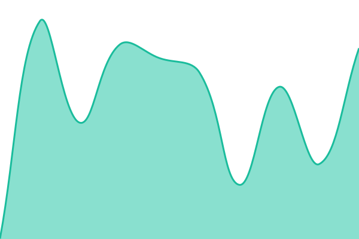
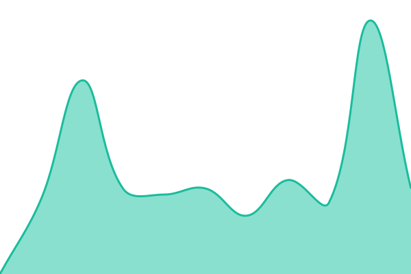

# [📈 Live Status](https://status.sefi360.com.br): <!--live status--> **🟩 All systems operational**

This repository contains the open-source uptime monitor and status page for [sefi360master-creator](https://status.sefi360.com.br), powered by [Upptime](https://github.com/upptime/upptime).

With [Upptime](https://upptime.js.org), you can get your own unlimited and free uptime monitor and status page, powered entirely by a GitHub repository. We use [Issues](https://github.com/sefi360master-creator/status/issues) as incident reports, [Actions](https://github.com/sefi360master-creator/status/actions) as uptime monitors, and [Pages](https://status.sefi360.com.br) for the status page.

<!--start: status pages-->
<!-- This summary is generated by Upptime (https://github.com/upptime/upptime) -->
<!-- Do not edit this manually, your changes will be overwritten -->
<!-- prettier-ignore -->
| URL | Status | History | Response Time | Uptime |
| --- | ------ | ------- | ------------- | ------ |
|  [Aplicativo SEFi360](https://sefi360.com.br/) | 🟩 Up | [aplicativo-se-fi360.yml](https://github.com/sefi360master-creator/status/commits/HEAD/history/aplicativo-se-fi360.yml) | 

 689ms
     
 | 

<a href="https://status.sefi360.com.br/history/aplicativo-se-fi360">100.00%</a>
    

|  [Aplicativo - dados](https://sefi360.com.br/api/1.1/obj/cenarios_template?limit=1) | 🟩 Up | [aplicativo-dados.yml](https://github.com/sefi360master-creator/status/commits/HEAD/history/aplicativo-dados.yml) | 

 440ms
     
 | 

<a href="https://status.sefi360.com.br/history/aplicativo-dados">100.00%</a>
    

|  [Ambiente de testes](https://sefi360.com.br/version-test/) | 🟩 Up | [ambiente-de-testes.yml](https://github.com/sefi360master-creator/status/commits/HEAD/history/ambiente-de-testes.yml) | 

 681ms
     
 | 

<a href="https://status.sefi360.com.br/history/ambiente-de-testes">100.00%</a>
    

|  Motores de calculo | 🟩 Up | [motores-de-calculo.yml](https://github.com/sefi360master-creator/status/commits/HEAD/history/motores-de-calculo.yml) | 

 509ms
     
 | 

<a href="https://status.sefi360.com.br/history/motores-de-calculo">100.00%</a>
    

|  [Pagina de acesso](https://acesso.sefi360.com.br/) | 🟩 Up | [pagina-de-acesso.yml](https://github.com/sefi360master-creator/status/commits/HEAD/history/pagina-de-acesso.yml) | 

 444ms
     
 | 

<a href="https://status.sefi360.com.br/history/pagina-de-acesso">100.00%</a>
    

|  [Noticias](https://noticias.sefi360.com.br/) | 🟩 Up | [noticias.yml](https://github.com/sefi360master-creator/status/commits/HEAD/history/noticias.yml) | 

 445ms
     
 | 

<a href="https://status.sefi360.com.br/history/noticias">100.00%</a>
    

<!--end: status pages-->

[**Visit our status website →**](https://status.sefi360.com.br)

## 📄 License

- Powered by: [Upptime](https://github.com/upptime/upptime)
- Code: [MIT](./LICENSE) © [Anand Chowdhary](https://anandchowdhary.com)
- Data in the `./history` directory: [Open Database License](https://opendatacommons.org/licenses/odbl/1-0/)
